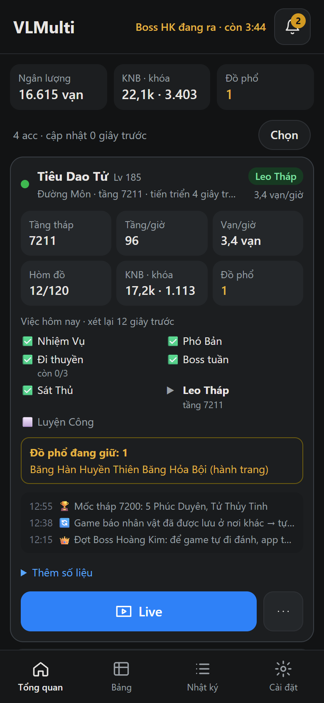
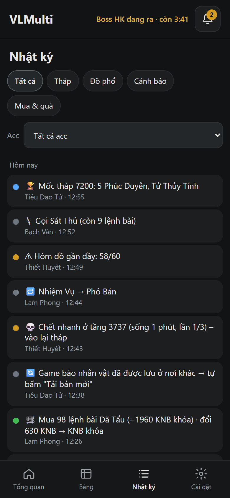
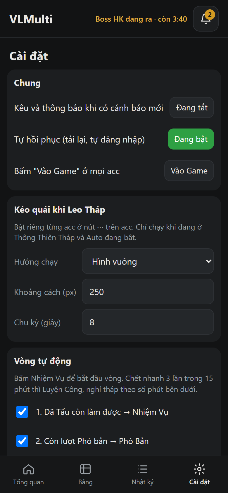
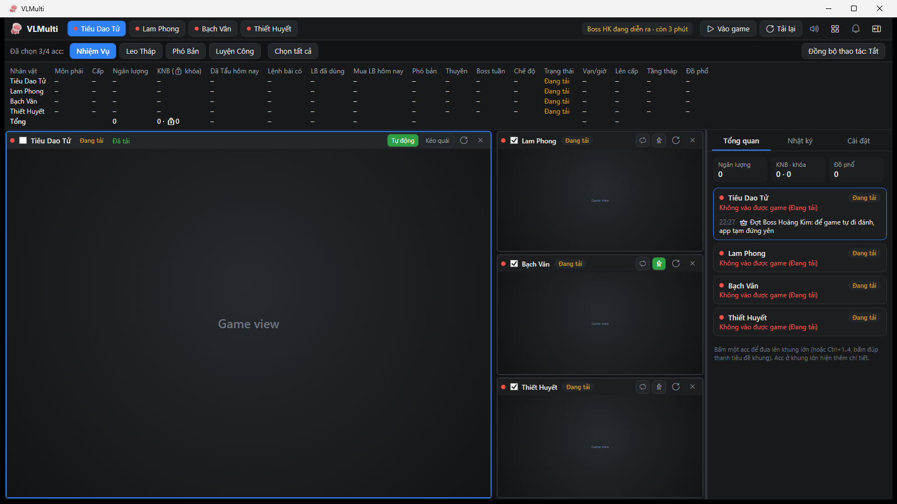

<p align="center">
  
</p>

<h1 align="center">VLTK-IDLE · VLMulti</h1>

<p align="center">
  Run and babysit several <a href="https://volamidle.pages.dev/">Võ Lâm Idle</a> characters at once:<br>
  from a Windows desktop app, or 24/7 from a small Linux server and your phone.
</p>

<p align="center">
  
  
  
  
  
</p>

<p align="center">
  
  &nbsp;
  
  &nbsp;
  
</p>

> Võ Lâm Idle is a free, non-commercial fan game that runs in the browser. VLMulti is a personal hobby project
> that keeps four characters running and does the daily routine for them. The in-game UI is Vietnamese, and so is
> VLMulti's UI.

---

## What it does

**Daily auto-loop.** One button (*Nhiệm Vụ*) starts a loop that works through the day's to-do list, then
keeps climbing:

```
Gifts → Dã Tẩu quests → Dungeons → Boat trips → Weekly boss → Assassin tokens → Tower → Farming
```

- Buys the daily Dã Tẩu quest tokens with locked KNB. It converts KNB and opens red envelopes when short.
- Each step is checked against the game's own counters, such as `162/162`, `Chuyến còn hôm nay 2/3` or
  `Lượt còn 3/3`. A step is done when its counter says so, not when a timer runs out.
- Boat trips and weekly-boss attempts are paced one at a time. Failures are retried, and a step is skipped after
  three failures in a row.

**Hands-off when the game takes over.**
- During the Golden Boss waves (12:00 · 15:30 · 19:30 · 22:00 Vietnam time), the game moves characters by itself, so
  the app stands still.
- Detects server maintenance from the game's own `jx_bt_now` check and its maintenance overlay. Every account
  shows *Bảo trì* and nothing is clicked until it ends.

**Self-healing.** Reloads crashed or frozen pages and logs back in with saved passwords. Re-enters the game, clicks
*Tải bản mới* when the save is taken elsewhere, and rests the tower after repeated fast deaths.

**Tower helpers.** An optional *kite* mode runs the character in a square so mobs bunch up. Logs 100-floor
milestone rewards and golden-item drops, and keeps an inventory of held *Đồ phổ* (recipe items).

**Visibility.**
- Health light per account: green / amber / red, with the reason.
- Today's to-do checklist, gold per hour, floors per hour, and bag fullness.
- A merged activity log with filters, and alerts with sound and notifications.

## Two ways to run it

| | **Desktop** (`VLMulti.exe`) | **Server** (`VLMulti.Server`) |
|---|---|---|
| Runs on | Windows 10/11 | Linux x64 / ARM64 (e.g. an Oracle Cloud free VM) or Windows |
| Browser | 4 × WebView2 inside the window | Headless Chromium via Playwright |
| You control it from | The app window | A mobile-first web page (installable as a PWA) |
| Watch a character | It's on screen | *Live* view: CDP screencast over WebSocket, with tap/scroll forwarding |
| Saved passwords | Encrypted with Windows DPAPI | AES with a key file that stays on the server |

Both share the same brain (`VLMulti.Core`), so the auto-loop, recovery and detection rules behave the same.
**Don't run both on the same accounts at the same time.** They will keep stealing each other's session.

<p align="center">
  
  <br><sub>Desktop layout preview: one large and three small game frames, with the side panel (overview · log · settings). Game frames show a placeholder.</sub>
</p>

## Project layout

```
src/
  VLMulti.Core/      Shared logic: AccountController (per-account brain), mode rules, schedules,
                     parsers, settings, credential store, and the in-page agent (Page/agent.js)
  VLMulti.Desktop/   WPF + WebView2 app
  VLMulti.Server/    ASP.NET Core minimal API + Playwright; web UI in wwwroot/
tests/
  VLMulti.Tests/     xUnit tests for the controller, rules and parsers
  agent/             Page-parser tests on text captured from the real game (node --test), post-deploy smoke check
deploy/linux/        install.sh + systemd unit
publish.ps1          Package the desktop app (single self-contained .exe)
publish-server.ps1   Package the server for linux-x64, linux-arm64 and win-x64
```

**How it works.** A small script (`agent.js`) is injected into every game page before the game loads. It reads
the DOM: level, gold, mode, quest counters, chat system lines, bag and tooltips. Every 1.5 s it posts a status
message, and it runs named commands such as `mode`, `boat`, `weekBoss` or `assassin` by clicking the game's own
buttons. `AccountController` turns those status messages into decisions every few seconds. It is pure C#, with no
browser dependency, so almost all behavior is covered by unit tests with a fake page.

## Getting started

Requires the [.NET 8 SDK](https://dotnet.microsoft.com/download/dotnet/8.0) to build.

### Desktop (Windows)

```powershell
git clone https://github.com/hawonjungo/VLTK-IDLE.git
cd VLTK-IDLE
powershell -ExecutionPolicy Bypass -File publish.ps1   # runs the tests, then builds dist\VLMulti\VLMulti.exe
```

Run `dist\VLMulti\VLMulti.exe`. It needs the [WebView2 Runtime](https://developer.microsoft.com/microsoft-edge/webview2/),
which is already installed on Windows 11. Add your game accounts under **Cài đặt → Tài khoản & mật khẩu game…**,
or log in by hand once and let the app offer to save the password.

Shortcuts:

| Shortcut | Action |
|---|---|
| `Ctrl+1` … `Ctrl+4` | Move an account to the large frame |
| `Ctrl+B` | Show / hide the side panel |
| Double-click a frame's title bar | Move that account to the large frame |
| Drag a frame's title bar | Swap two frames |

To share the app, send only `VLMulti.exe`. **Never send the `data` folder next to it**: it holds your browser
sessions and saved passwords.

### Server (Linux, phone control)

```powershell
powershell -ExecutionPolicy Bypass -File publish-server.ps1   # tests + dist\VLMulti.Server-linux-arm64.tar.gz (and x64, win-x64)
```

Copy the archive to the server and install:

```bash
tar -xzf VLMulti.Server-linux-arm64.tar.gz
cd VLMulti.Server-linux-arm64
sudo bash install.sh
```

`install.sh` does the following:
- creates a `vlmulti` system user;
- copies the app to `/opt/vlmulti`;
- installs Chromium and its dependencies;
- asks for the web page password;
- starts a `systemd` service that restarts automatically.

Data lives in `/var/lib/vlmulti/data`. Running `install.sh` again to update keeps that data.

Then open `http://<server>:8080` and add the game passwords under **Cài đặt**. Useful commands:

```bash
journalctl -u vlmulti -f                                   # live log
sudo -u vlmulti /opt/vlmulti/VLMulti.Server --set-password <new> --data /var/lib/vlmulti/data
```

**Don't expose port 8080 to the internet.** Reach it through a private network such as
[Tailscale](https://tailscale.com/), which is how this project is used day to day. The page is password-protected,
and the live view checks the request origin, but a VPN is still the right boundary.

Server tuning (viewport, frame rate, live-view quality, listen address) lives in `data/server.json`.

## Data & privacy

All runtime data stays in a local `data/` folder: browser profiles, `settings.json`, `credentials.json` and logs.
That folder is git-ignored.
- Game passwords are encrypted at rest: DPAPI on the desktop, AES with a local key file on the server.
- They are never written to logs or sent anywhere except the game's own login form.
- The web page password is stored only as a PBKDF2 hash.

## Development

```powershell
dotnet test tests/VLMulti.Tests                  # 99 tests (also runs tests/agent with Node)
dotnet run --project src/VLMulti.Desktop          # desktop, data goes to .\data next to the .sln
dotnet run --project src/VLMulti.Server -- --data data-server
```

Set `VLMULTI_DEBUG_PORT=9333` to open a Chrome DevTools port (bound to `127.0.0.1`) on the game pages. This is handy
for inspecting the game's DOM when it changes.

## Disclaimer

This is an unofficial, personal project. It is not affiliated with or endorsed by the makers of Võ Lâm Idle. It only
automates what a player can do by clicking in the normal game UI. It does not modify game files, network traffic, or
the server. Use it considerately and respect the game's rules and community.
